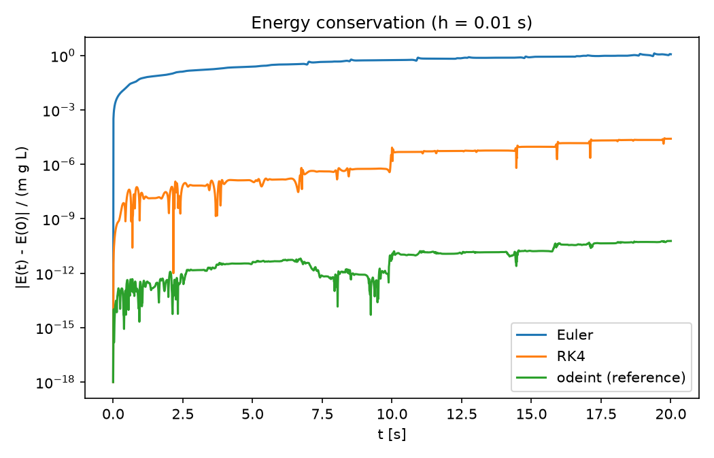
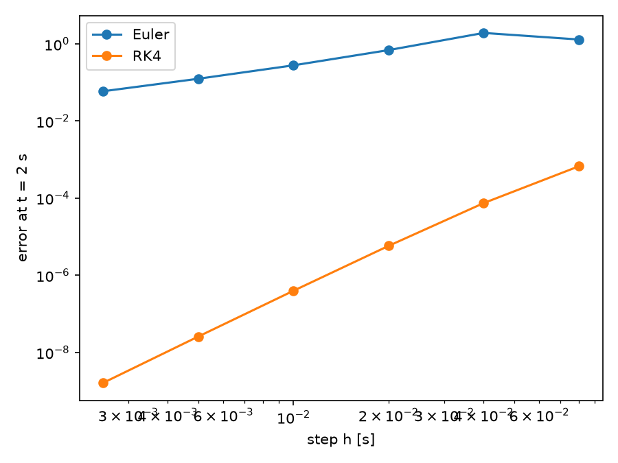
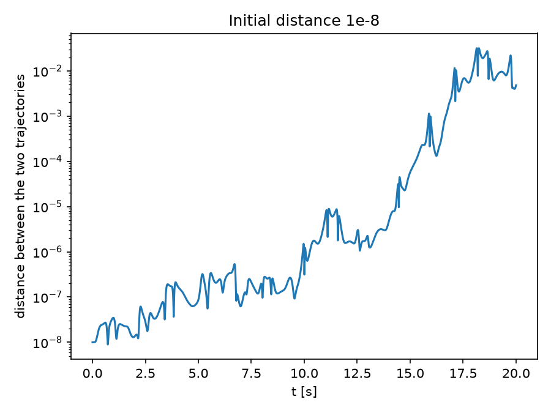

# Double Pendulum: numerical integrators and chaos

Simulation of a frictionless double pendulum in Python (NumPy / SciPy). The project
compares three ways of solving the equations of motion, using **energy conservation**
and **convergence order** as quality measures, and quantifies the chaotic behaviour with
the **largest Lyapunov exponent**.


## Results

Reproduced by running `python pendulum.py` (both rods horizontal and at rest,
`m1 = m2 = 1`, `L1 = L2 = 1`).

| Method | Max. energy drift over 20 s (step h = 0.01 s) | Measured convergence order |
|---|---|---|
| Explicit Euler | 131 % of the energy scale `m g L` | 1.18 (theory: 1) |
| Runge-Kutta 4 (own implementation) | 0.0027 % | 3.93 (theory: 4) |
| SciPy `odeint`, tolerance 1e-12 (reference) | 6 × 10⁻⁹ % | n/a (adaptive step) |

Since the system has no friction, the energy must stay constant. Euler gains energy
artificially and RK4 almost does not.



The convergence plot shows how the error at t = 2 s shrinks when the step is reduced.
The slope of each line is the order of the method.



**Chaos.** Two trajectories that start 10⁻⁸ apart separate roughly exponentially
until they saturate. The largest Lyapunov exponent, estimated with the Benettin method,
is about **0.9 s⁻¹** for the initial condition above (between 0.84 and 0.98 s⁻¹
depending on the integration time and integrator settings) and about **0.001 s⁻¹** for small
oscillations, which means regular motion.



## Tests

`pytest` checks that:

- the equilibrium point does not move;
- the small-oscillation frequency matches the theoretical value `ω² = g (2 − √2)`;
- the reference solution conserves energy to better than 1e-8;
- Euler's energy drifts while RK4's does not;
- RK4 is 4th order (halving the step divides the error by about 16);
- the Lyapunov exponent is positive for chaotic motion and about 0 for small angles.

## How to run

```bash
git clone https://github.com/tomiaubin/double-pendulum.git
cd double-pendulum
pip install -r requirements.txt
pytest              # run the tests
python pendulum.py  # print the numbers above and regenerate the figures
```

## Files

- `pendulum.py`: equations of motion, energy, Euler, RK4, Lyapunov exponent and the analysis.
- `test_pendulum.py`: tests.
- `notebooks/pendulo_doble.ipynb`: the original notebook, in Spanish, with the derivation of the equations and the animations.

## Author

Tomás Aubin, Physics undergraduate at UBA.
